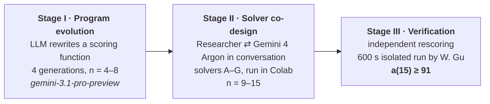

# PSS × OEIS A397960 — a(15) ≥ 91

**Two 15-element subsets of {0, …, 105} with 91 distinct positive differences each, found by LLM-written search code and checked independently.**

[](https://oeis.org/A397960)
[-%E2%89%A5%2091-2ea44f)](#the-result)
[](#license)
[](#license)

**Authors:** Chien-Cheng Dennis Lin (Symbiosis Lab / Project Soul Seed) · Wujie (Gavin) Gu (author of OEIS A397960)
**Full documentation:** [English (readme_EN.md)](readme_EN.md) · [繁體中文 (README_ZH.md)](README_ZH.md)

> **Status.** a(15) ≥ 91 is a **constructive lower bound**. It is not a proof that a(15) = 91. Whether 92 is possible is still open.

---

## Contents

1. [The problem in one minute](#the-problem-in-one-minute)
2. [The result](#the-result)
3. [Check it yourself (10 seconds)](#check-it-yourself-10-seconds)
4. [How it was found](#how-it-was-found)
5. [Who did what](#who-did-what)
6. [What we claim, and what we do not](#what-we-claim-and-what-we-do-not)
7. [An observation: arithmetic runs in the middle](#an-observation-arithmetic-runs-in-the-middle)
8. [Repository contents](#repository-contents)
9. [Timeline](#timeline)
10. [Open questions](#open-questions)
11. [Citation](#citation)
12. [AI-use disclosure](#ai-use-disclosure)
13. [中文摘要](#中文摘要)

---

## The problem in one minute

Choose **n** integers from the range **0 … m**, where m = n(n−1)/2. The n numbers form n(n−1)/2 pairs, so they produce at most m positive differences. [A397960](https://oeis.org/A397960)(n) is the largest number of **distinct** differences you can get.

- **n = 4, m = 6.** {0, 1, 4, 6} gives differences 1, 2, 3, 4, 5, 6. All six are distinct, so a(4) = 6.
- **n ≥ 5.** No choice works perfectly (this is the classical fact that perfect Golomb rulers stop at 4 marks). Some differences must repeat, and some values in 1 … m are left uncovered.

The known values (OEIS DATA, n = 3..14) are:

| n | 3 | 4 | 5 | 6 | 7 | 8 | 9 | 10 | 11 | 12 | 13 | 14 | **15** |
|:--|:-:|:-:|:-:|:-:|:-:|:-:|:-:|:-:|:-:|:-:|:-:|:-:|:-:|
| m | 3 | 6 | 10 | 15 | 21 | 28 | 36 | 45 | 55 | 66 | 78 | 91 | **105** |
| a(n) | 3 | 6 | 9 | 13 | 19 | 26 | 32 | 40 | 49 | 58 | 68 | 79 | **≥ 91** (this work) |

The OEIS values were computed by exhaustive branch-and-bound search. The cost grows quickly with n, and n = 15 had no known value.

---

## The result

| Family | Subset (15 elements, max 105) | Distinct differences | Missing from 1…105 |
|:--|:--|:-:|:--|
| **91-1** | `0 3 4 13 29 40 51 62 73 85 90 97 103 104 105` | **91** | 21 55 66 67 71 78 79 80 83 88 89 95 96 98 |
| **91-2** | `0 2 6 15 17 29 39 49 59 69 79 97 100 104 105` | **91** | 16 19 60 70 72 74 78 81 84 86 92 93 96 101 |

- The two subsets are **not** mirror images of each other under x ↦ 105 − x, so they are two different solutions.
- They were found by the multi-family explorer ([`solvers/multi_family_explorer.py`](solvers/multi_family_explorer.py)) in a 600-second run of 1,052 trials. W. Gu performed the run in an isolated container (`python3 -I`). Every configuration it emitted was rescored from scratch by separate code, with zero discrepancies (`bad = 0`).
- Before that, the search had found **9 configurations with 90 differences**, forming **8 distinct families**. They are listed in [`data/a397960_witnesses.json`](data/a397960_witnesses.json).

---

## Check it yourself (10 seconds)

No libraries are needed. Paste this into any Python 3:

```python
for S in ([0,3,4,13,29,40,51,62,73,85,90,97,103,104,105],
          [0,2,6,15,17,29,39,49,59,69,79,97,100,104,105]):
    assert len(S) == 15 and S[0] == 0 and S[-1] == 105
    print(len({b - a for a in S for b in S if b > a}))   # prints 91
```

For the full check, run [`verify.py`](verify.py). It covers all witnesses for n = 9–15, steps, missing differences and the mirror test.

```bash
python3 -I verify.py
```

---

## How it was found

The work had three stages. They were of very different kinds, and we keep them separate because each supports a different claim.



**Stage I: program evolution (n = 4–8).**
An automated loop asked the model to write one function, `priority_score`. A greedy builder used that function to build each subset, and the loop scored the result on n = 4–8. The prompts were shaped by the Project Soul Seed protocol: discourage flattery, lock the output format, and explain why plain greedy fails. In four generations the program changed in these ways:

| Gen | Total (n = 4–8) | What the program did |
|:-:|:-:|:--|
| 0 | 67 | Pure greedy |
| 1 | 72 | Collision penalty and boundary weighting |
| 2 | 72 | 2–3 step exact lookahead |
| 3 | **73** | Beam-search lookahead; all of n = 4–8 at the OEIS values |
| 4 | 73 | Bitmasks plus budgeted branch-and-bound, including a pruning bound that is algebraically equivalent to the one in the OEIS program |

**Stage II: solver co-design (n = 9–15).**
The researcher worked with Gemini 4 Argon in the Gemini web app. The model wrote solvers, the researcher ran them in Colab and reported the results, and the model revised them. The path, including the dead ends:

| Solver | Idea | Outcome |
|:--|:--|:--|
| A | Beam search + 1-opt | n = 9–11 from scratch; **first a(15) = 90** (5.93 s); n = 12–14 stuck 1 short |
| B | Simulated annealing | No improvement at all |
| C | Exact LNS, remove 3–4 points | **a(12) = 58** (2.20 s) |
| D | Tabu LNS, remove 4–5 | **a(13) = 68** (4.42 s) |
| E | Deep LNS, remove 5–6 | **a(14) = 79** (8.31 s) |
| F | Many independent beam-search families | 8 distinct 90-point configurations |
| G | F + mirror-aware deduplication + rescoring audit | **a(15) ≥ 91** (600 s run by W. Gu) |

The step that mattered was going from small moves (1-opt, annealing) to large moves. Pulling out 3–6 points at once and refilling them exactly got past the plateaus that were one point short.

**Stage III: verification.**
Every subset in this repository was rescored by independent code. W. Gu also confirmed that the 9 configurations with 90 differences are valid, and that two of them are mirror images. A later review by W. Gu found that one part of an earlier collision analysis was simple arithmetic rather than evidence, and that its causal reading was backwards. The corrected reading is the one given below.

The per-result details (code version, start condition, run times) are in [readme_EN.md §8](readme_EN.md).

---

## Who did what

| | Contribution |
|:--|:--|
| **W. Gu** | Defined A397960 and computed a(3)–a(14) (a(13) jointly with S. A. Irvine). Reviewed the methodology. Ran the isolated 600 s experiment that produced a(15) ≥ 91. Confirmed the equivalence of the pruning bound. |
| **C.-C. D. Lin** | Set up the Stage I loop. Directed the Stage II conversations and ran all the code in Colab. Did the structural analysis, documentation and verification. |
| **Gemini models** | Wrote all the search code: `gemini-3.1-pro-preview` inside the Stage I loop, and Gemini 4 Argon in the Stage II conversations. |

The first author is not a specialist in combinatorics. Part of what this repository documents is how far a non-specialist can get by working with an LLM under a clear protocol, while checking every number with independent code.

---

## What we claim, and what we do not

| We claim | We do **not** claim |
|:--|:--|
| a(15) ≥ 91, with two explicit witnesses anyone can check | That a(15) = 91 |
| The search code was written by LLMs, with a human directing and running it | That the LLM "discovered" the solution unaided |
| Stage I reached the known values for n = 4–8 | That Stage I was blind: its feedback included the known optimum for each n |
| n = 9–11 were reached from scratch | That n = 12–14 were reached from scratch: they were warm starts from seeds 1 point short, with the record as the target |
| The Gen-4 pruning bound is equivalent to the OEIS bound | That the bound is new: it is the standard bound, and the prompts gave no code for it |

---

## An observation: arithmetic runs in the middle

Both 91-point subsets contain a run of equal steps in the middle:

```
91-2:  0 2 6 15 17 │29 39 49 59 69 79│ 97 100 104 105     six marks, step 10
91-1:  0 3 4 13 │29 40 51 62 73│ 85 90 97 103 104 105    five marks, step 11
```

This is surprising because an arithmetic run is the most wasteful shape possible. A run of k marks has C(k,2) pairs but only k − 1 distinct differences. In 91-2 the run uses 6 of the 15 marks (40%), and by itself it accounts for 10 of the set's 14 repeated differences (71%). The set still matches the best value known. So the marks at the two ends must be making up for this cost, and **how they do so is an open question.** It can be tested directly: fix the run, search only the ends, and see whether that finds high scores faster than unconstrained search.

**We treat this as a hypothesis, not a result.** Only two 91-point subsets are known. Details are in [readme_EN.md §5.4](readme_EN.md).

---

## Repository contents

| Path | What it is |
|:--|:--|
| `README.md` | This page |
| [`readme_EN.md`](readme_EN.md) / [`README_ZH.md`](README_ZH.md) | Full documentation: all tables, stage details, caveats, provenance |
| [`verify.py`](verify.py) | Zero-dependency verification of every witness (n = 9–15) |
| [`solvers/multi_family_explorer.py`](solvers/multi_family_explorer.py) | **The exact code that produced a(15) ≥ 91** (solver G) |
| [`solvers/reference_lns.py`](solvers/reference_lns.py) | A short reference re-implementation of the LNS idea, for reading. *Not the code that produced the results*; measured performance is in its header |
| [`data/a397960_witnesses.json`](data/a397960_witnesses.json) | All witnesses with steps and missing differences, machine-readable |
| [`CITATION.cff`](CITATION.cff) | Citation metadata (GitHub shows a "Cite this repository" button) |
| `LICENSE` | MIT for code; CC BY 4.0 for data and text |

Solvers A–F and the Stage I loop with its prompts will be released with the accompanying paper.

---

## Timeline

| Date (2026) | Event |
|:--|:--|
| Aug 13 | A397960 submitted to OEIS by W. Gu |
| Aug 27 | a(13) = 68 added (S. A. Irvine) |
| Sep 03 | a(14) = 79 added by W. Gu; sequence approved |
| Oct 14 | Stage I and Stage II runs in Colab; a(9)–a(14) reproduced; a(15) ≥ 90 found; this repository made public |
| Oct 16 | W. Gu's isolated 600 s run: **a(15) ≥ 91**, two witnesses, `bad = 0` |

---

## Open questions

1. **Is a(15) = 91?** Proving it needs an exhaustive search, for example a sharded run of the OEIS branch-and-bound.
2. **Is the middle arithmetic run usable structure, or a by-product?** Fix a run of step Δ and length k, search only the ends, and compare against unconstrained search under the same time budget, sweeping Δ = 10–12 and k = 4–6.
3. **How much did the protocol prompt matter?** The planned test runs Stage I with and without the Project Soul Seed constraints, and with and without known-optimum feedback, several times each.
4. **Does the method reach n = 16** (m = 120)?

Contributions of witnesses, counter-examples or exhaustive results are welcome via Issues.

---

## Citation

Please cite the sequence itself as:

> Wujie Gu, Sequence A397960, *The On-Line Encyclopedia of Integer Sequences*, https://oeis.org/A397960.

For this repository:

```bibtex
@misc{lin_gu_2026_a397960,
  author       = {Lin, Chien-Cheng Dennis and Gu, Wujie},
  title        = {{PSS × OEIS A397960}: a constructive lower bound a(15) $\geq$ 91
                  from LLM-written search code},
  year         = {2026},
  howpublished = {\url{https://github.com/symboisislab/PSS-A397960-Discovery}},
  note         = {Accessed: <date>}
}
```

Related: O. Pikhurko and T. Schoen, "Sets with many distinct differences," *Integers* 7 (2007) #A11 (cited in the OEIS entry). OEIS data deposit: doi:10.5281/zenodo.22302268.

---

## AI-use disclosure

All search code in this repository was written by Google Gemini models: `gemini-3.1-pro-preview` in the Stage I loop, and Gemini 4 Argon in the Stage II conversations through the Gemini web app. The authors ran the code, checked the results and directed the revisions. Every reported subset was verified by independent code. This page was drafted with the help of Claude (Anthropic) under the authors' Project Soul Seed / Symbiosis Protocol, and the authors reviewed it before publication.

## License

Code: MIT License. Data and documentation: CC BY 4.0. © 2026 Chien-Cheng Dennis Lin (Symbiosis Lab) and Wujie Gu.

---

## 中文摘要

**一句話：** 我們找到兩組 15 個元素、取自 0…105 的子集，每組都有 91 個相異正差值，因此 **a(15) ≥ 91**。這是構造性下界，不是 a(15) = 91 的證明。

- **問題：** 從 0…n(n−1)/2 中選 n 個整數，最多能產生幾個不同的正差值？這就是 [A397960](https://oeis.org/A397960)，由 Gavin (Wujie) Gu 建立。n = 15 原本沒有已知值。
- **方法：** 分三個階段。
  - 第一階段：在 Project Soul Seed 協議約束下，讓 LLM 演化評分函數（n = 4–8）。
  - 第二階段：研究者與 Gemini 4 Argon 對話，共同設計求解器，在 Colab 執行（n = 9–15）。關鍵在於從小幅修改改成「一次拔掉 3–6 個點再精確重填」的大鄰域搜尋。
  - 第三階段：以獨立程式重算全部結果，並由 Gavin 在隔離容器中執行 600 秒，取得 91 分的兩組見證。
- **誠實註記：**
  - 第一階段的回饋含已知最佳值，所以不是盲測。
  - n = 12–14 是從差 1 分的種子出發補上的。
  - 中段等差段是觀察，不是結論。
- **自己驗證：** 上方「Check it yourself」的五行程式，貼進 Python 即可。

完整中文說明請見 [README_ZH.md](README_ZH.md)。

---

### Revision log

| Version | Date | Changes |
|:--|:--|:--|
| V1.0 | 2026-10-14 | First landing page (a(15) ≥ 90; Gemini 2.5 Flash; "9 non-isomorphic families"). |
| **V2.0** | 2026-10-16 | Rewritten as a full landing page, aligned with readme_EN / README_ZH V1.4 r3. (1) Result updated to a(15) ≥ 91 with both witnesses and their missing differences. (2) Corrected the model name (`gemini-3.1-pro-preview` / Gemini 4 Argon), the family count (8 families among 9 configurations at 90), and "exact reproduction of a(3)…a(14)" (now from-scratch n = 9–11 vs. warm-start n = 12–14). (3) Removed "hallucination-free" and "bi-level closed loop", which described the system inaccurately. (4) Added: a one-minute problem explanation, a 5-line check, a stage diagram, a solver path including failures, a who-did-what table, a claims / non-claims table, the observation section, repository contents, timeline, open questions, citation, AI disclosure and a Chinese summary. |
| V2.1 | 2026-10-16 | Following W. Gu's addendum (V1.1): rewrote the observation section around the cost of the arithmetic run (the run creates its own collisions; the earlier "concentrates collisions" reading reversed the causality). Removed the 0.48% / 5% baselines until they are recomputed under a fixed rule. Sharpened open question 2 into a testable experiment. Updated readme_EN / README_ZH to V1.4 r4. |
